# Toko Kita - Flutter App

Aplikasi mobile toko sederhana berbasis Flutter yang terhubung ke REST API CodeIgniter 4 (`toko-api`).

## Fitur
- Registrasi akun member
- Login & Logout
- Melihat daftar produk
- Melihat detail produk
- Tambah produk baru
- Ubah data produk
- Hapus produk

## Teknologi
- **Frontend**: Flutter (Dart)
- **Backend**: CodeIgniter 4 REST API
- **Database**: MySQL

---

## Screenshots

### Halaman Login

| Referensi Modul | Hasil Aplikasi |
|:-:|:-:|
| 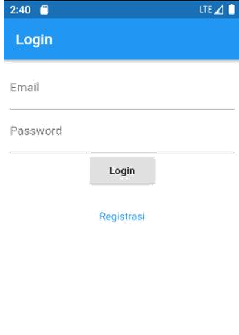 | 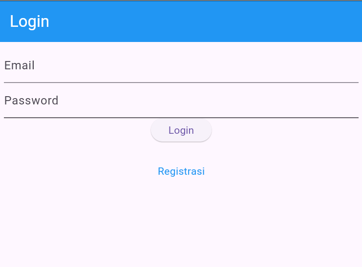 |

---

### Halaman Registrasi

| Referensi Modul | Hasil Aplikasi |
|:-:|:-:|
| 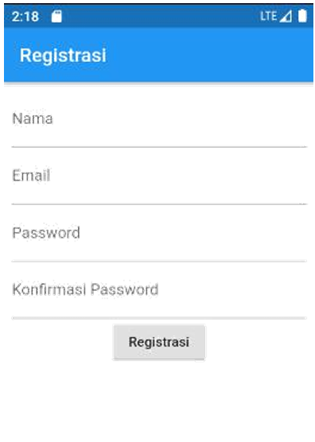 | 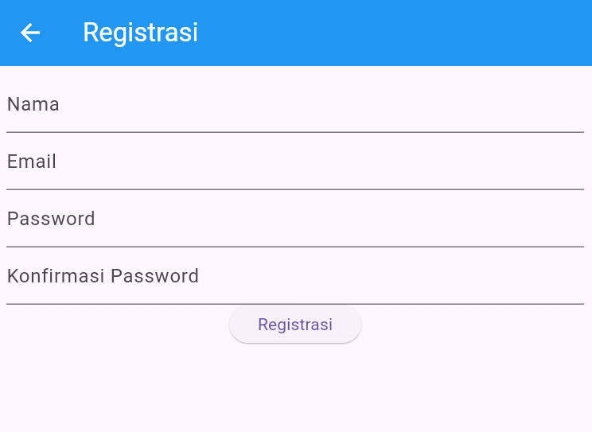 |

---

### Halaman List Produk

| Referensi Modul | Hasil Aplikasi |
|:-:|:-:|
| 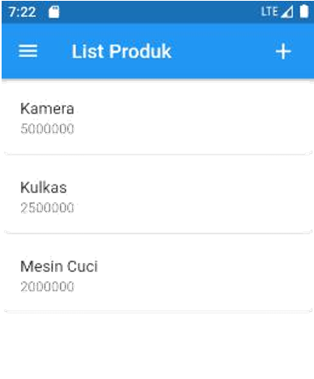 | 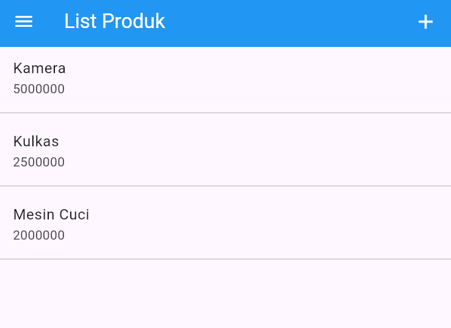 |

---

### Halaman Tambah Produk

| Referensi Modul | Hasil Aplikasi |
|:-:|:-:|
| 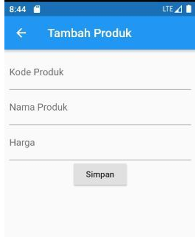 | 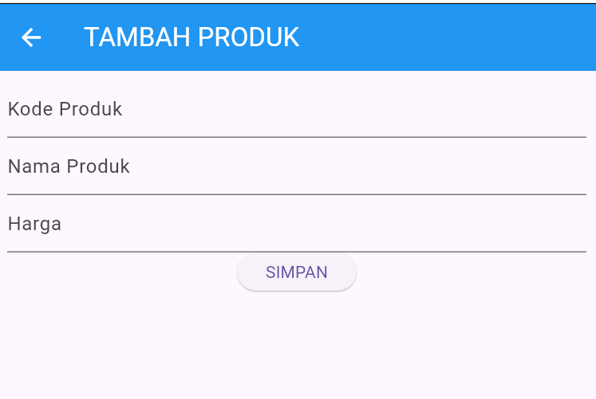 |

---

### Halaman Detail Produk

| Referensi Modul | Hasil Aplikasi |
|:-:|:-:|
| 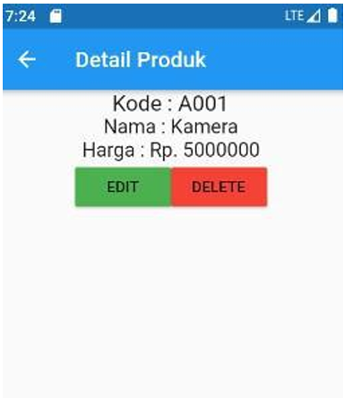 | 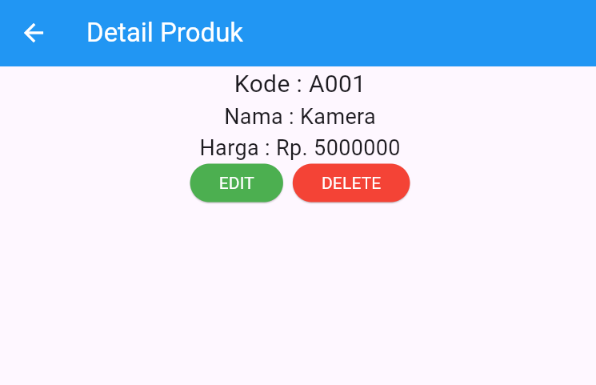 |

**Dialog Konfirmasi Hapus:**

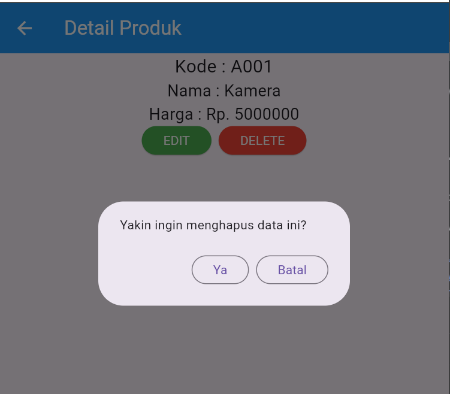

---

### Halaman Ubah Produk

| Referensi Modul | Hasil Aplikasi |
|:-:|:-:|
| 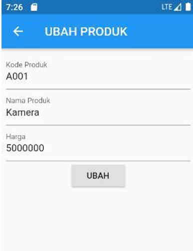 | 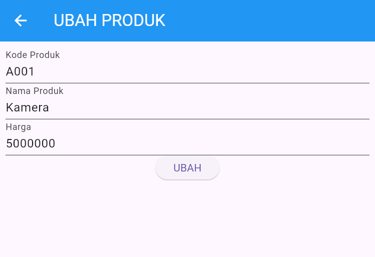 |

---

## Struktur Project

```
tokokita/
├── lib/
│   ├── main.dart
│   ├── model/
│   │   ├── login.dart
│   │   ├── registrasi.dart
│   │   └── produk.dart
│   └── ui/
│       ├── login_page.dart
│       ├── registrasi_page.dart
│       ├── produk_page.dart
│       ├── produk_form.dart
│       └── produk_detail.dart
└── screenshots/
```

## Cara Menjalankan

```bash
cd tokokita
flutter run
```
